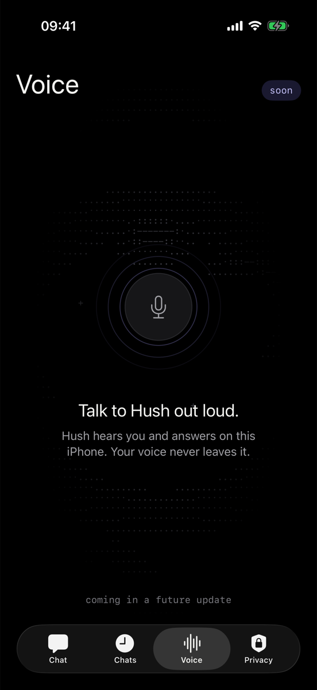

# Hush


Hush is a private AI chat for iPhone. It runs fully on the device with Apple Foundation Models. There is no account, no cloud and no tracking. It works in airplane mode.

<p align="center">
  
  
  
  
</p>

## Features

- **Private chat.** Replies stream on the device. Markdown, lists and code blocks show with their own styles.
- **Chats.** SwiftData keeps your chats on the iPhone. You can search them.
- **Face ID lock.** Hush locks when it goes to the background.
- **Privacy screen.** It shows the bytes that your chats send. The value is always `0 B`.
- **Hush keyboard.** A system keyboard with a tone bar. It rewrites your text in any app.
- **Share extension.** Share text from any app to Hush and get a rewrite.
- **Tones.** Kinder, Shorter, Longer, Formal, English, Spanish, or your own instruction.
- **Monitor panel.** Reply speed, CPU, frames, memory, network and thermal state.
- **Dark and light themes** with a live ASCII background.

## Requirements

- Xcode 26 or later
- iOS 26 or later
- An iPhone with Apple Intelligence turned on, to get real replies

Without Apple Intelligence, Hush shows a short message that explains how to turn it on.

## Run

1. Open `Hush.xcodeproj`.
2. Select your team in Signing & Capabilities for each target.
3. Run the `Hush` scheme.

Run the tests with `Cmd+U` or:

```sh
xcodebuild test -project Hush.xcodeproj -scheme Hush -destination 'platform=iOS Simulator,name=iPhone 17 Pro'
```

### Turn on the keyboard

Go to Settings > General > Keyboard > Keyboards > Add New Keyboard and select Hush. The keyboard does not ask for full access.

## Structure

| Folder | Content |
|---|---|
| `Hush/App` | Root view, tab bar, lock flow, settings keys, debug launch options |
| `Hush/Theme` | Dark and light palettes, type styles, motion |
| `Hush/Field` | The live ASCII background (`FieldEngine`, `AsciiField`) |
| `Hush/Components` | Wordmark, app mark, buttons, chips |
| `Hush/Chat` | Chat screen, composer, message boxes, streaming text, Markdown |
| `Hush/Engine` | `ReplyEngine`, the on-device reply stream, and reply metrics |
| `Hush/Monitor` | Monitor panel, system sampler, frame meter |
| `Hush/Data` | SwiftData models |
| `Hush/Screens` | Onboarding, lock, Chats, Voice, Privacy |
| `Rewrite` | `Rewriter` and tones, shared by the keyboard and the share extension |
| `HushKeyboard` | The Hush keyboard extension |
| `HushShare` | The share extension with the rewrite card |
| `Config` | Info.plist files for the extensions |
| `HushTests` | Unit tests |
| `scripts` | App icon generator and power monitor |
| `docs/screenshots` | Screenshots for this file |

## Debug launch options

Debug builds read these launch arguments:

- `-HushTab chats|voice|privacy` opens a tab.
- `-HushPrompt "text"` sends a message on launch.
- `-HushSimulate YES` streams a sample reply, for the simulator.
- `-HushMonitor YES` opens the monitor panel.

## App icon

```sh
swift scripts/make-icon.swift Hush/Assets.xcassets/AppIcon.appiconset
```

## Reply speed and power

Hold the send button for 10 seconds to open the monitor panel above the input box. It shows Neural Engine reply speed, CPU, interface frames, memory, network and thermal state.

Each reply logs its speed in the `chat` category:

```sh
log stream --predicate 'subsystem == "com.pdsdm.hush"' --level info
```

`scripts/power-monitor.c` shows CPU, GPU and Neural Engine power on an Apple Silicon Mac, without `sudo`:

```sh
clang -O2 scripts/power-monitor.c -o power-monitor -framework CoreFoundation -lIOReport
./power-monitor 30
```

## License

Hush is available under the MIT License. See [LICENSE](LICENSE).
