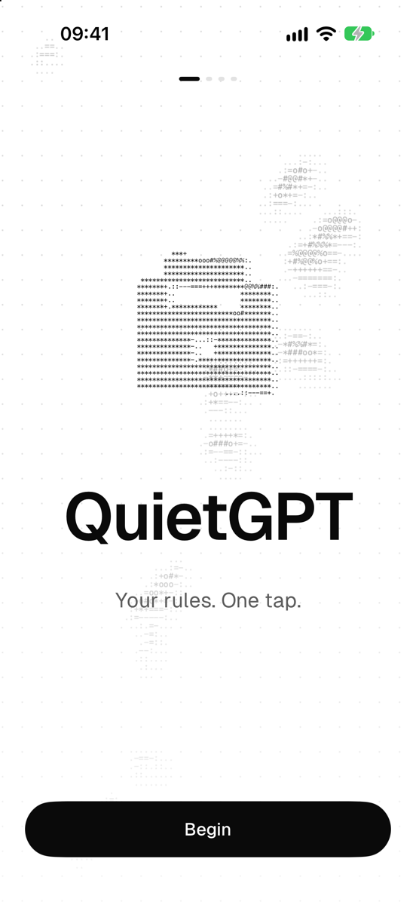
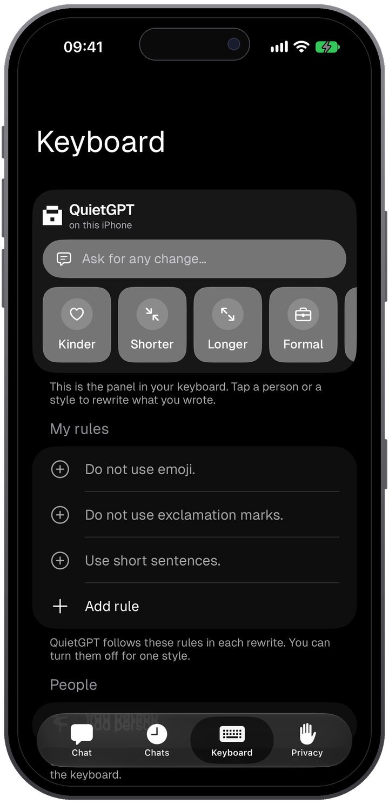
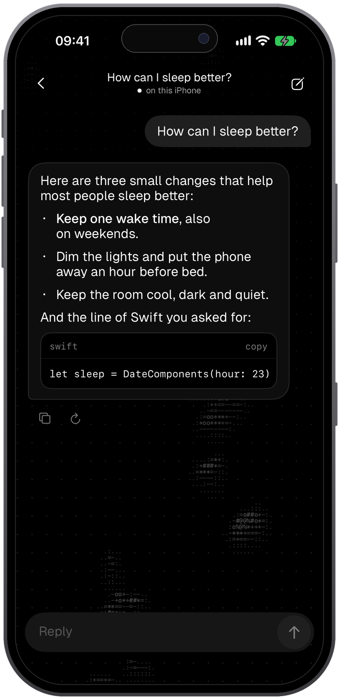
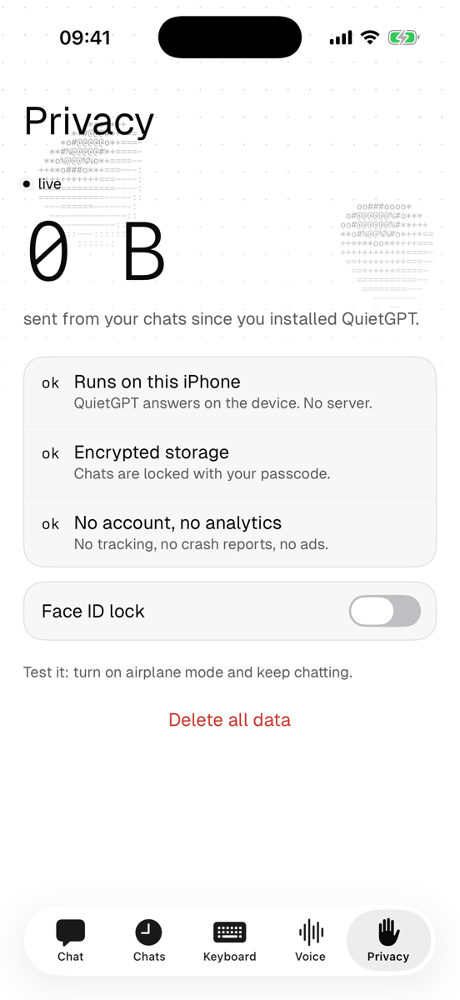

<div align="center">


# QuietGPT

**Rewrite your messages with your own rules, in one tap, in any app.**

A keyboard, a share card and a private chat for iPhone. All text stays on your iPhone. No account, no cloud, no tracking.

[Get the app](#get-the-app) · [Features](#features) · [Privacy](#privacy) · [Build from source](#build-from-source) · [Contributing](#contributing)


[](LICENSE)






</div>

## Why QuietGPT?

A message to your manager and a message to your best friend need different words. Most AI writing tools send both messages to a server, and they do not know how you write.

- **Private by default.** Apple Foundation Models does the work on your iPhone. QuietGPT has no server.
- **Your rules, each time.** You write the rules once. QuietGPT follows them in each rewrite.
- **In all apps.** Use the keyboard or the share sheet. You do not copy and paste between apps.
- **Works offline.** QuietGPT works in Airplane Mode.
- **Free and open source.** No account and no subscription. MIT license.

## Contents

- [Features](#features)
- [Get the app](#get-the-app)
- [Requirements](#requirements)
- [Quick start](#quick-start)
- [Privacy](#privacy)
- [How it works](#how-it-works)
- [Troubleshooting](#troubleshooting)
- [Build from source](#build-from-source)
- [Developer tools](#developer-tools)
- [Project structure](#project-structure)
- [Roadmap](#roadmap)
- [Contributing](#contributing)
- [License](#license)
- [Acknowledgments](#acknowledgments)

## Features

### Rewrite

- **QuietGPT keyboard.** It looks and types like the iOS keyboard. It has accent variants, cursor control on the space bar and an emoji page with all categories, recent emojis and skin tones. The lock key opens the rewrite panel. You can set the key height and the top margin in the Keyboard tab. The top row shows the logo, which opens the panel, and the functions that you choose in the same tab.
- **Share card.** Share text from any app to QuietGPT and get a rewrite.
- **Styles.** Kinder, Shorter, Longer, Formal, Fix, English, Spanish or your own instruction. Edit, add and order styles in the Keyboard tab. You can also change the base instructions.
- **My rules.** Up to 10 short rules that QuietGPT follows in each rewrite. Each style can turn them off. Fix and the translations do not use them by default.
- **People.** Save how you write to one person. People show first in the panel.
- **Language.** The panel sets the language to Auto, English or Spanish.
- **Style packs.** Send your rules and styles as a `.quietgpt` file. Open a file to read it and add it. QuietGPT does not share your people.

### Chat

- **Private chat.** Replies stream on the iPhone. Markdown, lists and code blocks have their own styles.
- **Chats.** QuietGPT keeps your chats on the iPhone. You can search them.

### Protection

- **Face ID lock.** QuietGPT locks when it goes to the background.
- **Monitor panel.** It shows reply speed, CPU, frames, memory, network and thermal state.

### Design

- **Dark and light themes.**
- **Live background.** An ASCII lava lamp follows gravity. You can drag it with your finger.

## Get the app

QuietGPT is not in the App Store yet. To use it now, [build it from source](#build-from-source).

## Requirements

### To use QuietGPT

| Item | Requirement |
|---|---|
| System | iOS 26 or later |
| iPhone | iPhone 15 Pro, iPhone 15 Pro Max, iPhone Air, iPhone 16 or later |
| Apple Intelligence | On, and finished its download |
| Language | Device and Siri set to the same language, and Apple Intelligence supports it |
| Storage | On iOS 27: up to 8 GB for Apple Intelligence, or up to 14 GB on iPhone 17 Pro and later |

QuietGPT does not include this download. iOS installs Apple Intelligence. See [How to get Apple Intelligence](https://support.apple.com/en-us/121115) for the current list.

QuietGPT runs only on iPhone. It does not have an iPad version.

### To build QuietGPT

| Item | Requirement |
|---|---|
| Mac | A Mac that runs Xcode 26 or later |
| Xcode | 26 or later, with the iOS 26 SDK or later |
| Apple account | Necessary to run on an iPhone. Not necessary for the simulator |
| Packages | None. The project has no third-party packages |

Real replies need an iPhone with Apple Intelligence. In the simulator, use [`-QuietGPTSimulate YES`](#debug-launch-options) to get a sample reply.

## Quick start

1. Open QuietGPT and complete the first launch screens.
2. Go to Settings > General > Keyboard > Keyboards > Add New Keyboard and select QuietGPT. The keyboard does not ask for full access.
3. Open the Keyboard tab in QuietGPT. Add your rules, and add the people you write to.
4. In any app, write a message and switch to the QuietGPT keyboard.
5. Tap the lock key and select a style or a person.

## Privacy

| Data | Where it stays |
|---|---|
| Text that you rewrite | It goes to Apple Foundation Models on the iPhone |
| Chats | SwiftData in a private app folder, with `NSFileProtectionComplete`. iCloud Backup and computer backups do not include this folder, so chats do not move to a new iPhone |
| Rules, styles and people | The app group on the iPhone, shared with the keyboard and the share card. Backups do not include this settings folder |
| Style packs | On the iPhone, until you send the file. A pack does not include your people |

QuietGPT has no account, no analytics, no ads and no third-party packages. The keyboard does not ask for full access. **Delete all data** in the Privacy tab removes chats, rules, people and styles.

### What the Privacy tab measures

Each second, the app looks for its own internet connections and reads the bytes sent on TCP connections. The Privacy tab shows these bytes and the number of connections.

| Limit | Effect |
|---|---|
| Apple's writing service | It runs outside QuietGPT, and iOS does not count its bytes. The value does not include this service |
| Short connections | A connection that opens and closes between two checks is not counted |
| UDP | The connection is counted, but its bytes are not available |
| Keyboard | Its count is added only if iOS lets it save to the app group |

To check network activity on the iPhone, go to Settings > Privacy & Security > App Privacy Report.

### Check it yourself

Turn on Airplane Mode and send a message. Or search the source for network code. This command prints nothing:

```sh
grep -rE 'URLSession|import Network|https?://' QuietGPT QuietGPTKeyboard QuietGPTShare Rewrite --include='*.swift'
```

The Monitor panel also shows live network use for the full iPhone.

## How it works

| Layer | What it does |
|---|---|
| **Keyboard and share card** | `QuietGPTKeyboard` reads the text in the field. `QuietGPTShare` receives the text that you share. |
| **Rewrite** | `Rewriter` adds your style, rules and base instructions to the text. It streams the result. All targets use this shared code. |
| **Chat** | `ReplyEngine` streams each reply to the chat screen. SwiftData keeps the chat. |
| **Apple Foundation Models** | The system framework. It runs on the iPhone, and iOS manages the download. |

## Troubleshooting

| Problem | Solution |
|---|---|
| The panel shows "QuietGPT needs Apple Intelligence" | Go to Settings > Apple Intelligence & Siri and turn it on. |
| The panel shows "Apple Intelligence is still getting ready" | Wait for the download to finish. Then try again. |
| "This text is too long" | Select a shorter part of the text. |
| "The text field changed, so the rewrite stopped" | Stay in the same field until the rewrite is done. |
| "The cursor moved, so undo is off" | Undo works only while the cursor is after the rewritten text. |
| The chat shows "I can't think yet on this iPhone" | Do the same step. Then make sure that your iPhone is in the [list](#to-use-quietgpt). |
| "QuietGPT can't rewrite this language yet" | Apple Intelligence does not support this language. Set the panel to a language that it supports. |
| "QuietGPT can't rewrite this one" | The system refused this text. Try another style. |
| The keyboard is not in the list | Add it. See [Quick start](#quick-start), step 2. |
| Xcode shows a signing error | Create `Config/Local.xcconfig`. See [Build from source](#build-from-source), step 2. |
| The simulator gives no replies | Use [`-QuietGPTSimulate YES`](#debug-launch-options) if the simulator has no Apple Intelligence. |

## Build from source

1. Clone the repository and open `QuietGPT.xcodeproj`.

   ```sh
   git clone https://github.com/pdsdm/QuietGPT.git
   cd QuietGPT
   open QuietGPT.xcodeproj
   ```

2. To use your own team, create `Config/Local.xcconfig`. It overrides `Config/Base.xcconfig`, and git ignores it.

   ```
   DEVELOPMENT_TEAM = YOUR_TEAM_ID
   QUIETGPT_BUNDLE_PREFIX = com.example.quietgpt
   ```

3. Run the `QuietGPT` scheme.

### Tests

Press `Cmd+U` or run this command. To see the simulators that you have, run `xcrun simctl list devices available`. If you have more than one iOS version and the command does not find the simulator, add the version, for example `name=iPhone 17 Pro,OS=26.0`.

```sh
xcodebuild test -project QuietGPT.xcodeproj -scheme QuietGPT -destination 'platform=iOS Simulator,name=iPhone 17 Pro'
```

## Developer tools

### Debug launch options

Debug builds read these launch arguments:

| Argument | Result |
|---|---|
| `-QuietGPTTab chat\|chats\|keyboard\|voice\|privacy` | Opens a tab |
| `-QuietGPTPrompt "text"` | Sends a message on launch |
| `-QuietGPTSimulate YES` | Streams a sample reply, for the simulator |
| `-QuietGPTMonitor YES` | Opens the monitor panel |
| `-QuietGPTFocus YES` | Puts the cursor in the input box |

### Reply speed and power

Hold the send button for 10 seconds to open the monitor panel above the input box.

Each reply logs its speed in the `chat` category:

```sh
log stream --predicate 'subsystem == "com.pdsdm.hush"' --level info
```

`scripts/power-monitor.c` shows CPU, GPU and Neural Engine power on an Apple Silicon Mac, without `sudo`:

```sh
clang -O2 scripts/power-monitor.c -o power-monitor -framework CoreFoundation -lIOReport
./power-monitor 30
```

### Generated files

```sh
swift scripts/make-icon.swift QuietGPT/Resources/Assets.xcassets/AppIcon.appiconset
```

`scripts/make-emoji.py` makes `QuietGPTKeyboard/EmojiData.swift` from the Unicode emoji list.

## Project structure

| Folder | Content |
|---|---|
| `QuietGPT/App` | App entry, root view, tab bar, lock flow, settings keys, debug launch options |
| `QuietGPT/Features` | One folder for each screen: `Chat`, `History`, `Keyboard`, `Voice`, `Privacy`, `Onboarding`, `Lock`, `Splash`, `Monitor` |
| `QuietGPT/Core` | `ReplyEngine` and reply metrics, SwiftData objects, Markdown parser |
| `QuietGPT/DesignSystem` | Palettes, type styles, motion, components, the live ASCII background |
| `QuietGPT/Resources` | Asset catalog with the app icon and accent color |
| `Rewrite` | `Rewriter`, styles, style packs, brand font and keyboard colors. The app, the keyboard and the share card use this code |
| `QuietGPTKeyboard` | The keyboard extension |
| `QuietGPTShare` | The share extension with the rewrite card |
| `QuietGPTTests` | Unit tests, in the same folders as the code that they test |
| `Config` | Build settings, entitlements and Info.plist files |
| `scripts` | App icon generator, emoji list generator and power monitor |
| `docs/screenshots` | Screenshots for this file |

## Roadmap

- **Voice.** The Voice tab is a preview only. Voice comes in a future update.

## Contributing

- **Bugs and ideas.** Open an [issue](https://github.com/pdsdm/QuietGPT/issues). For a bug, give your iPhone, your iOS version and the steps.
- **Code.** Open an issue before a large change. Add tests in `QuietGPTTests`, and make sure that all tests pass before you open a pull request.
- **Translations.** Each target has a `Localizable.xcstrings` file: `QuietGPT`, `QuietGPTKeyboard` and `QuietGPTShare`. They have English and Spanish now. The Monitor panel stays in English.
- **Privacy.** Do not add network code, analytics or third-party packages.

## License

QuietGPT is available under the MIT License. See [LICENSE](LICENSE).

## Acknowledgments

- [Geist](https://github.com/vercel/geist-font), the brand font, under the [SIL Open Font License](Rewrite/Fonts/Geist-OFL.txt).
- [Apple Foundation Models](https://developer.apple.com/foundation-models-framework/), which does the work on the iPhone.
