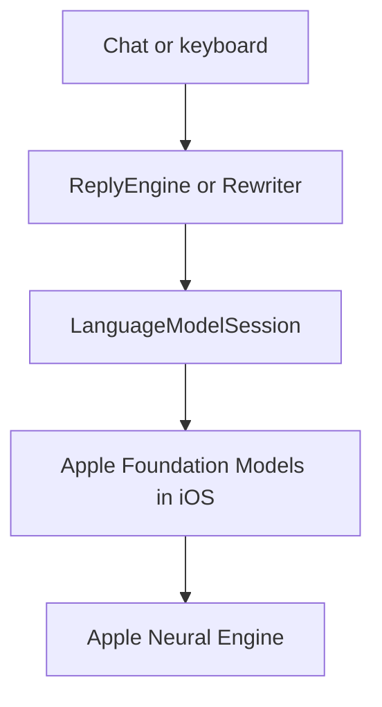

# QuietGPT on the Apple Neural Engine

QuietGPT replies come from the Apple Neural Engine (ANE), not from the GPU. We measured this on iPhone hardware. This document gives the method, the data, the benefits, the tradeoffs and the limits of the evidence.

## Contents

- [Summary](#summary)
- [What the ANE is](#what-the-ane-is)
- [How QuietGPT uses the ANE](#how-quietgpt-uses-the-ane)
- [Evidence from the iPhone](#evidence-from-the-iphone)
- [Why the ANE is better for QuietGPT](#why-the-ane-is-better-for-quietgpt)
- [Tradeoffs](#tradeoffs)
- [What this data does not prove](#what-this-data-does-not-prove)
- [Repeat the tests](#repeat-the-tests)
- [Data files](#data-files)
- [Sources](#sources)

## Summary

All tests ran on an iPhone 16 Pro Max.

| Question | Result |
|---|---|
| Does the ANE work during a reply? | Yes. It is busy 84–87% of the time while text streams, and 0% just before the reply |
| Did all test replies use the ANE? | Yes. All 14 replies with ANE data have ANE events |
| Does the AI work appear on the GPU? | No separate AI process appears on the GPU |
| How fast is a long reply? | About 21 and about 48 tokens/s in two tests |
| How much power does it use? | No watt or battery number yet. Instruments gives only impact scores |
| Is the GPU free when the app is idle? | Not on most tabs. The tabs with the animated background use 39–92% of GPU time, with no reply running. With the background off, the idle Chat tab uses 0% |

## What the ANE is

The ANE is a separate part of Apple chips. It does the math of neural networks. It is not the CPU and it is not the GPU.

Most apps that run a language system on an iPhone use the GPU. These tools include llama.cpp and MLX. Apple's research team reports that the ANE can run such work at low power. Their 2022 study measured a small text network on iPhone 13: 3.47 ms at 0.454 W. That study does not measure QuietGPT.

## How QuietGPT uses the ANE

**QuietGPT does not program the ANE directly.** It calls Apple Foundation Models, and iOS selects the hardware. The API that QuietGPT calls has no setting for CPU, GPU or ANE. We know the result because we measured it, not because we set it.



The main call is short:

```swift
let session = LanguageModelSession(instructions: instructions)
for try await snapshot in session.streamResponse(to: prompt) {
    continuation.yield(snapshot.content)
}
```

QuietGPT does this work around that call:

| Step | Code | Why |
|---|---|---|
| Check that the system is ready | `SystemLanguageModel.default.availability` | The app shows a clear message if Apple Intelligence is off or not ready |
| Load before the first message | `prewarm()` in `ReplyEngine` and `Rewriter` | The first text comes sooner |
| Stream each reply | `streamResponse(to:)` | The user sees text while the ANE works |
| Keep one session for each chat | `sessions` in `ReplyEngine` | The session keeps the context of the chat |
| Recall old chats | `recallTurns` is 8, `recallCharacters` is 600 | A new session gets a short recap |
| Recover from a full context | `exceededContextWindowSize`, then `retryTurns` is 4 | The chat continues with less history |
| Allow text rewrites | `guardrails: .permissiveContentTransformations` in `Rewriter` | Fewer rewrites are refused |

The app contains no AI weights. iOS installs them with Apple Intelligence. The debug build for the simulator is 12 MB.

## Evidence from the iPhone

**Test setup:** iPhone 16 Pro Max (A18 Pro), iOS 27.0.1, 30 October 2026. We recorded the full iPhone with Instruments, with the Core ML template and the GPU instrument. The recording reads hardware tables. It does not use a label in the app.

### One long reply

The reply had 1,297 characters, about 324 tokens. The first text came after 4.00 s. The total time was 19.26 s, about 21 tokens each second.

<picture>
  <source media="(prefers-color-scheme: dark)" srcset="charts/iphone-busy-dark.png">
  
</picture>

| Phase | Seconds | ANE busy | QuietGPT GPU time, each second | System compositor GPU time, each second |
|---|---|---|---|---|
| Before the reply | 0–8 | 0% | about 9 ms | 132–281 ms |
| Load and read the prompt | 9–11 | 7–34% | 8–14 ms | 116–261 ms |
| Text streams | 13–27 | 87% on average (76–93%) | 36–87 ms | about 163 ms |
| After the reply | 29–40 | 0% | 8–46 ms | 129–229 ms |

The table of hardware events shows 546 `Neural Engine Prediction` events and 6 `Load: cached` events.

The GPU time of QuietGPT goes up during the reply. We think that this is the text animation, because the app draws more in that time. The trace cannot confirm the cause.

### Twelve replies in one session

Each reply window comes from the time in the QuietGPT log.

| Reply | Window (s) | ANE busy | ANE events | First text (s) | Total (s) | Characters |
|---|---|---|---|---|---|---|
| 1 | 24.03–26.96 | 29.8% | 50 | 2.76 | 2.93 | 65 |
| 2 | 40.64–42.53 | 35.0% | 58 | 1.64 | 1.89 | 99 |
| 3 | 51.41–54.15 | 50.6% | 114 | 1.69 | 2.74 | 183 |
| 4 | 63.92–66.04 | 75.7% | 142 | 0.54 | 2.12 | 256 |
| 5 | 73.67–75.25 | 66.6% | 88 | 0.54 | 1.58 | 202 |
| 6 | 83.36–86.83 | 52.8% | 122 | 2.09 | 3.47 | 290 |
| 7 | 92.09–95.40 | 99.1% | 186 | 2.20 | 3.31 | 217 |
| 8 | 110.21–113.06 | 55.5% | 100 | 1.68 | 2.85 | 193 |
| 9 | 119.32–120.95 | 63.0% | 78 | 0.68 | 1.63 | 176 |
| 10 | 138.85–140.12 | 49.1% | 49 | 0.73 | 1.27 | 91 |
| 11 | 153.91–155.17 | 53.3% | 53 | 0.71 | 1.26 | 127 |
| 12 | 170.83–172.21 | 57.4% | 60 | 0.74 | 1.38 | 115 |

- **All 12 replies have ANE events.**
- **Short windows show lower percentages.** Each window starts when the user sends the message, so it includes time before the ANE starts.
- **84% of all ANE time is inside these windows** (15.39 s of 18.37 s). The app also loads at launch. The source of the other ANE work is not known. iOS can use the ANE for other features.
- **GPU use in the full recording:** the system compositor 58.62 s, QuietGPT 17.25 s, all others less than 0.25 s. No separate AI process appears.

### Second test, 4 November

**Test setup:** the same iPhone and iOS version, on the cable and charging. The build is a debug build. We did not record which commit it contains.

The reply had 1,591 characters, about 398 tokens. The first text came after 2.97 s. The total time was 11.28 s, about 48 tokens each second. The app log puts the start of the reply at 8.78 s, and the first ANE event comes at 8.81 s.

| Phase | Seconds | ANE busy |
|---|---|---|
| Before the reply | 0–7 | 0% |
| Load and read the prompt | 8–10 | 8–32% |
| Text streams | 11–19 | 84% on average (77–87%) |
| After the reply | 21–34 | 0% |
| No message sent | 35–36 and 38–42 | 3–87% |

The recording has 742 prediction events and 10 load events. Two of these events have a name: `md8-text-encoder_main_ctx_512__Op0_AneInference`. They come at 35.55 s and 35.72 s, after the reply.

**The ANE also works without a QuietGPT reply.** Second 35–42 in this table has no message. A recording of idle tabs with no message also has an ANE burst, with an average of 47% over 5 seconds. That recording also has an event named `sbert_quantized_mlprogram_main__Op1_AneInference`. The source of this work is not known. It can be iOS. For this reason, ANE activity alone does not prove a reply. The match in time does.

### GPU use when the app is idle

We opened one tab at a time, and we sent no message. The table gives QuietGPT GPU time. We ignored the first 10 seconds of each tab.

| Tab | Animated background (`LiquidField`) | Average GPU time, each second | Range |
|---|---|---|---|
| Keyboard, three tests | No | 0 ms | 0 ms |
| Chats | Yes | 453 ms | 386–570 ms |
| Privacy | Yes | 565 ms | 454–676 ms |
| Chat | Yes | 815 ms | 543–921 ms |

GPU time goes to zero on the only tab without the background. Chats and Privacy have no chat interface and still use the GPU.

To confirm the cause, we made a test build from one commit with a launch option that turns `LiquidField` off. We recorded the idle Chat tab in four phases and ignored the first 10 seconds of each phase. This test build is not in the repo.

| Phase | `LiquidField` | Seconds | Average QuietGPT GPU time, each second | Average compositor GPU time, each second |
|---|---|---|---|---|
| 1 | Off | 12–48 | 0 ms | 4 ms |
| 2 | On | 58–92 | 632 ms | 288 ms |
| 3 | Off | 103–138 | 0 ms | 0 ms |
| 4 | On | 149–189 | 768 ms | 302 ms |

**`LiquidField` causes the idle GPU use of the Chat tab.** With it off, the idle Chat tab uses no measurable GPU time.

The GPU use can jump with no change on the screen. In this test, it went up about 20 seconds after each launch with the field on, to about 885 ms each second. The app sends 120 GPU intervals each second, and each interval takes about 7.4 ms after the jump. The thermal state was `Nominal` when each jump came, so a thermal limit does not explain it. The cause of the jump is not known.

### Power impact

A `Power Profiler` recording gives these results for one reply on the same iPhone:

| Item | Result |
|---|---|
| Battery use of the full system | `0.0%/hr`. The iPhone was charging on the cable, so this is not a real value |
| Thermal state | `Serious` for the full recording. Charging, earlier tests and the app can each be part of the cause |
| CPU impact of QuietGPT | 20–24 from second 1 to second 4, and 0.1 from second 10 |
| GPU impact of QuietGPT | About 20 when idle, then about 13 |

Impact scores have no unit in Instruments. They are not watts. These scores do not show ANE power, so this test does not compare the ANE with the GPU.

## Why the ANE is better for QuietGPT

| Benefit | Status | Evidence |
|---|---|---|
| The AI work does not take GPU time | **Measured** | No AI process appears on the GPU. The GPU time of QuietGPT comes from its interface, mainly the animated background |
| Works in the keyboard | **By design** | This extension has a low memory limit, and QuietGPT loads no weights in it |
| No large download in the app | **By design** | iOS installs the weights. Other apps can use the same copy |
| Low power | **Reported by Apple, not measured in QuietGPT** | Apple's 2022 study measured 3.47 ms at 0.454 W on the iPhone 13 ANE, with a small text network |
| Less heat and more battery life | **Expected, not measured** | Low power suggests this, but we have no battery test. The animated background can also use more power than the ANE saves. We did not measure this |

## Tradeoffs

| Tradeoff | Effect | Data or source |
|---|---|---|
| **Reply speed changes** | Long replies ran at about 21 and about 48 tokens/s on the same iPhone. The cause of the difference is not known. The ANE was busy 84–87% of the time in both | iPhone tests |
| **First text can be late** | The first text took 0.54–4.00 s on iPhone | iPhone tests |
| **No hardware control** | QuietGPT cannot select the ANE or check it live. iOS can change this in an update | API used by the app |
| **No choice of AI system** | QuietGPT cannot change its size, its weights or its quality | Apple Foundation Models |
| **Apple safety filters** | Some harmless requests can get a refusal | `guardrailViolation` and `refusal` in `ReplyEngine` |
| **Limited context** | Long chats can fill the context. QuietGPT then starts again with less history | `exceededContextWindowSize` in `ReplyEngine` |
| **Fewer devices** | It needs Apple Intelligence, so iPhone 15 Pro or later, and up to 8–14 GB of storage on iOS 27 | [Apple Support](https://support.apple.com/en-us/121115) |
| **Fewer languages** | Only the languages that Apple Intelligence supports | [Apple Support](https://support.apple.com/en-us/121115) |

## What this data does not prove

- **The events have no process name.** The ANE table does not name a process. We connect events to replies by their time.
- **We recorded chat replies only.** Keyboard rewrites use the same system framework, but we did not record them.
- **We tested one iPhone and one iOS version.** Other iPhones and iOS 26 are not tested.
- **We have no watt or battery data.** The iPhone was charging, and impact scores have no unit. We also did not compare the ANE with the GPU on an iPhone, so the report gives no number for how much better the ANE is.
- **The thermal state was `Serious` in the power recording.** The GPU and ANE can run slower at this state. We recorded the thermal state only in that recording.
- **The token count is an estimate.** Characters ÷ 4 is not a real count.  Very short replies give unreliable speed values.
- **The sample is small.** The ANE tables come from 14 replies on one iPhone.
- **The Monitor panel does not detect the ANE.** Its `neural engine` tile shows estimated reply speed. iOS gives apps no way to read ANE use. The label comes from these tests.

The raw recordings are not in this repo. The Oct 30 recordings no longer exist. The tables here keep their values, and the CSV files have the same numbers.

## Repeat the tests

1. Connect an iPhone with Apple Intelligence.
2. Unlock it, and set Auto-Lock to Never. Turn off the QuietGPT lock in the app. A locked iPhone gives a recording with no reply.
3. Find the device ID:

   ```sh
   xcrun devicectl list devices
   ```

4. Record the iPhone. While it records, send a long message in QuietGPT.

   ```sh
   xcrun xctrace record --device DEVICE_ID --template "Core ML" --instrument "GPU" --all-processes --time-limit 60s --output reply.trace
   ```

5. Make the table for each second:

   ```sh
   python3 scripts/ane-report.py reply.trace ane-output
   ```

If the ANE does the work, `ane_busy_percent` goes up during the reply and returns to 0 after it. If the GPU does the work, a large GPU column appears and the ANE stays at 0.

To read the reply time from the app log, add `--instrument "os_log"` to the command in step 4.

To read the power impact, record with the app as the target. One instrument in this template rejects `--all-processes`. For battery use, the iPhone must not charge. Replace `com.example.quietgpt` with your bundle prefix.

```sh
xcrun xctrace record --device DEVICE_ID --template "Power Profiler" --instrument "Thermal State" --time-limit 45s --output power.trace --launch -- com.example.quietgpt
```

### Make the charts again

```sh
python3 scripts/make-ane-charts.py docs/neural-engine
```

This script needs `matplotlib`.

## Data files

| File | Content |
|---|---|
| [`iphone-long-reply.csv`](data/iphone-long-reply.csv) | ANE busy percent and GPU time for each second of the long reply |
| [`iphone-12-replies.csv`](data/iphone-12-replies.csv) | ANE and GPU use, and speed, for each of the 12 replies |
| [`iphone-nov-reply.csv`](data/iphone-nov-reply.csv) | ANE busy percent and GPU time for each second of the 4 November reply |
| [`iphone-nov-idle-tabs.csv`](data/iphone-nov-idle-tabs.csv) | ANE busy percent and GPU time for each second, with the tab open and no message |
| [`iphone-nov-power-impact.csv`](data/iphone-nov-power-impact.csv) | CPU, GPU and display impact scores of QuietGPT for each second |
| [`iphone-nov-no-field.csv`](data/iphone-nov-no-field.csv) | GPU time for each second of the idle Chat tab, with `LiquidField` off and on |

## Sources

- [Apple: Deploying Transformers on the Apple Neural Engine](https://machinelearning.apple.com/research/neural-engine-transformers), 2022. The source of the iPhone 13 power figures.
- [Apple: Updates to Apple's On-Device and Server Foundation Language Models](https://machinelearning.apple.com/research/apple-foundation-models-2025-updates), 2025. This report does not name the ANE, so we measured it.
- [Apple: Foundation Models framework](https://developer.apple.com/foundation-models-framework/).
- [Apple Support: How to get Apple Intelligence](https://support.apple.com/en-us/121115).
- [Blake Crosley: Core ML vs MLX vs Foundation Models](https://blakecrosley.com/blog/core-ml-vs-mlx-vs-foundation-models). A third-party source. It also says that Foundation Models gives no control of compute units.
