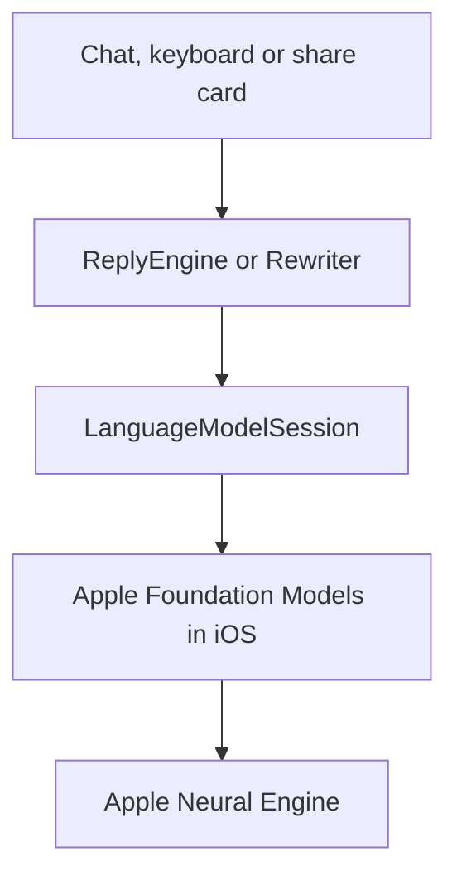
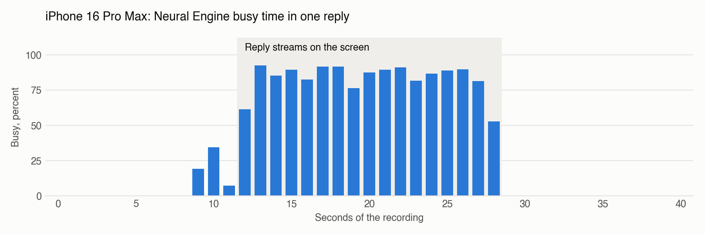
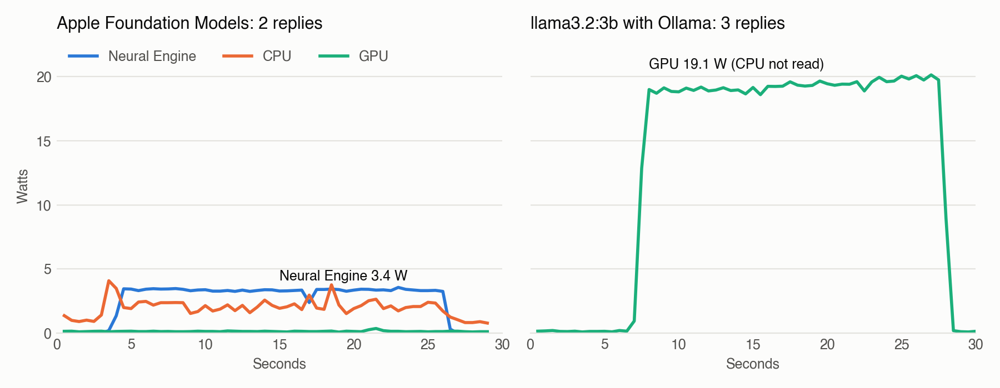

# QuietGPT on the Apple Neural Engine

QuietGPT replies come from the Apple Neural Engine (ANE), not from the GPU. We measured this on iPhone hardware. This document gives the method, the data, the benefits, the tradeoffs and the limits of the evidence.

## Contents

- [Summary](#summary)
- [What the ANE is](#what-the-ane-is)
- [How QuietGPT uses the ANE](#how-quietgpt-uses-the-ane)
- [Evidence from the iPhone](#evidence-from-the-iphone)
- [Evidence from the Mac](#evidence-from-the-mac)
- [Why the ANE is better for QuietGPT](#why-the-ane-is-better-for-quietgpt)
- [Tradeoffs](#tradeoffs)
- [What this data does not prove](#what-this-data-does-not-prove)
- [Repeat the tests](#repeat-the-tests)
- [Data files](#data-files)
- [Sources](#sources)

## Summary

| Question | Result | Device |
|---|---|---|
| Does the ANE work during a reply? | Yes. It is busy 87% of the time while text streams, and 0% before and after | iPhone 16 Pro Max |
| Did all test replies use the ANE? | Yes. All 12 replies have ANE events, 1,100 in total | iPhone 16 Pro Max |
| Does the AI work appear on the GPU? | No separate AI process appears on the GPU | iPhone 16 Pro Max |
| How much power does the ANE use? | 3.35 W, against 19.14 W for a similar open system on the GPU | M4 Pro Mac |
| Energy for each token | About 4.1 times less, chip against chip. At least 2.4 times less with the most careful count | M4 Pro Mac |
| What does the ANE cost? | Speed. The GPU test was about 1.4 times faster | M4 Pro Mac |

## What the ANE is

The ANE is a separate part of Apple chips. It does the math of neural networks. It is not the CPU and it is not the GPU.

Most apps that run a language system on an iPhone use the GPU. These tools include llama.cpp and MLX. Apple's research team reports that the ANE can run such work at low power. Their 2022 study measured a small text network on iPhone 13: 3.47 ms at 0.454 W. That study does not measure QuietGPT.

## How QuietGPT uses the ANE

**QuietGPT does not program the ANE directly.** It calls Apple Foundation Models, and iOS selects the hardware. The API that QuietGPT calls has no setting for CPU, GPU or ANE. We know the result because we measured it, not because we set it.



The main call is short:

```swift
let session = LanguageModelSession(instructions: instructions)
for try await snapshot in session.streamResponse(to: prompt) {
    continuation.yield(snapshot.content)
}
```

QuietGPT does this work around that call:

| Step | Code | Why |
|---|---|---|
| Check that the system is ready | `SystemLanguageModel.default.availability` | The app shows a clear message if Apple Intelligence is off or not ready |
| Load before the first message | `prewarm()` in `ReplyEngine` and `Rewriter` | The first text comes sooner |
| Stream each reply | `streamResponse(to:)` | The user sees text while the ANE works |
| Keep one session for each chat | `sessions` in `ReplyEngine` | The session keeps the context of the chat |
| Recall old chats | `recallTurns` is 8, `recallCharacters` is 600 | A new session gets a short recap |
| Recover from a full context | `exceededContextWindowSize`, then `retryTurns` is 4 | The chat continues with less history |
| Allow text rewrites | `guardrails: .permissiveContentTransformations` in `Rewriter` | Fewer rewrites are refused |

The app contains no AI weights. iOS installs them with Apple Intelligence. The debug build for the simulator is 12 MB.

## Evidence from the iPhone

**Test setup:** iPhone 16 Pro Max (A18 Pro), iOS 27.0.1, 30 October 2026. We recorded the full iPhone with Instruments, with the Core ML template and the GPU instrument. The recording reads hardware tables. It does not use a label in the app.

### One long reply

The reply had 1,297 characters, about 324 tokens. The first text came after 4.00 s. The total time was 19.26 s, about 21 tokens each second.

<picture>
  <source media="(prefers-color-scheme: dark)" srcset="charts/iphone-busy-dark.png">
  
</picture>

| Phase | Seconds | ANE busy | QuietGPT GPU time, each second | System compositor GPU time, each second |
|---|---|---|---|---|
| Before the reply | 0–8 | 0% | about 9 ms | 132–281 ms |
| Load and read the prompt | 9–11 | 7–34% | 8–14 ms | 116–261 ms |
| Text streams | 13–27 | 87% on average (76–93%) | 36–87 ms | about 163 ms |
| After the reply | 29–40 | 0% | 8–46 ms | 129–229 ms |

The table of hardware events shows 546 `Neural Engine Prediction` events and 6 `Load: cached` events.

The GPU time of QuietGPT goes up during the reply. We think that this is the text animation, because the app draws more in that time. The trace cannot confirm the cause. The Mac data supports it: GPU power did not change during replies.

### Twelve replies in one session

Each reply window comes from the time in the QuietGPT log.

| Reply | Window (s) | ANE busy | ANE events | First text (s) | Total (s) | Characters |
|---|---|---|---|---|---|---|
| 1 | 24.03–26.96 | 29.8% | 50 | 2.76 | 2.93 | 65 |
| 2 | 40.64–42.53 | 35.0% | 58 | 1.64 | 1.89 | 99 |
| 3 | 51.41–54.15 | 50.6% | 114 | 1.69 | 2.74 | 183 |
| 4 | 63.92–66.04 | 75.7% | 142 | 0.54 | 2.12 | 256 |
| 5 | 73.67–75.25 | 66.6% | 88 | 0.54 | 1.58 | 202 |
| 6 | 83.36–86.83 | 52.8% | 122 | 2.09 | 3.47 | 290 |
| 7 | 92.09–95.40 | 99.1% | 186 | 2.20 | 3.31 | 217 |
| 8 | 110.21–113.06 | 55.5% | 100 | 1.68 | 2.85 | 193 |
| 9 | 119.32–120.95 | 63.0% | 78 | 0.68 | 1.63 | 176 |
| 10 | 138.85–140.12 | 49.1% | 49 | 0.73 | 1.27 | 91 |
| 11 | 153.91–155.17 | 53.3% | 53 | 0.71 | 1.26 | 127 |
| 12 | 170.83–172.21 | 57.4% | 60 | 0.74 | 1.38 | 115 |

- **All 12 replies have ANE events.**
- **Short windows show lower percentages.** Each window starts when the user sends the message, so it includes time before the ANE starts.
- **84% of all ANE time is inside these windows** (15.39 s of 18.37 s). The app also loads at launch. The source of the other ANE work is not known. iOS can use the ANE for other features.
- **GPU use in the full recording:** the system compositor 58.62 s, QuietGPT 17.25 s, all others less than 0.25 s. No separate AI process appears.

## Evidence from the Mac

The Mac test gives power data, because `scripts/power-monitor.c` can read energy counters on a Mac. It gives a direct comparison with the GPU on the same M4 Pro chip.

<picture>
  <source media="(prefers-color-scheme: dark)" srcset="charts/mac-power-dark.png">
  
</picture>

| Measure | Apple Foundation Models on the ANE | `llama3.2:3b` on the GPU |
|---|---|---|
| Date | 30 October 2026 | 4 November 2026 |
| Tool | Apple framework | Ollama 0.40.14, reported as `100% GPU` |
| Parameters and weights | About 3 billion, 2 bits per weight (Apple, 2025) | 3.2 billion, `Q4_K_M` |
| Replies | 2 | 3 |
| ANE power while it writes | 3.35 W | 0 W |
| GPU power while it writes | 0.15 W (0.13 W when idle) | 19.14 W (0.17 W when idle) |
| CPU power while it writes | 2.14 W (1.00 W when idle) | Not available |
| Speed, characters ÷ 4 | 80.5 tokens/s | 113.2 tokens/s |
| Speed, real tokens | Not available | 93.0 tokens/s |

### Energy for each token

We use characters ÷ 4 for both systems, because Foundation Models does not give a token count.

| Count | ANE system | GPU system | Difference |
|---|---|---|---|
| Main chip part only: ANE against GPU | 3.35 W, 41.6 mJ | 19.14 W, 169.1 mJ | 4.1 times less |
| All measured power above idle on the ANE side, GPU only on the other side | 4.50 W, 55.9 mJ | 19.14 W, 169.1 mJ | 3.0 times less |
| **Most careful:** all measured power on the ANE side with idle included, GPU only on the other side | 5.64 W, 70.0 mJ | 19.14 W, 169.1 mJ | **At least 2.4 times less** |

The last row is the safest number. It counts all power on the ANE side, but it does not count the CPU on the GPU side. The true difference is probably larger.

## Why the ANE is better for QuietGPT

| Benefit | Status | Evidence |
|---|---|---|
| Less power while it writes | **Measured on Mac** | 3.35 W against 19.14 W |
| Less energy for each token | **Measured on Mac** | At least 2.4 times less |
| The GPU stays free for the interface | **Measured** | On Mac, GPU power stays flat. On iPhone, no AI process appears on the GPU |
| Works in the keyboard and the share card | **By design** | These extensions have low memory limits, and QuietGPT loads no weights in them |
| No large download in the app | **By design** | iOS installs the weights. Other apps can use the same copy |
| Less heat and more battery life on iPhone | **Expected, not measured** | Lower power suggests this, but we have no iPhone power or heat test |

## Tradeoffs

| Tradeoff | Effect | Data or source |
|---|---|---|
| **Lower speed than the GPU** | On the Mac, the GPU test was about 1.4 times faster | 113.2 against 80.5 tokens/s |
| **Long replies are slow on iPhone** | The long reply ran at about 21 tokens/s. The ANE was busy 87% of the time, so the limit is not the interface | iPhone test |
| **First text can be late** | The first text took 0.54–4.00 s on iPhone | iPhone test |
| **No hardware control** | QuietGPT cannot select the ANE or check it live. iOS can change this in an update | API used by the app |
| **No choice of AI system** | QuietGPT cannot change its size, its weights or its quality | Apple Foundation Models |
| **Apple safety filters** | Some harmless requests can get a refusal | `guardrailViolation` and `refusal` in `ReplyEngine` |
| **Limited context** | Long chats can fill the context. QuietGPT then starts again with less history | `exceededContextWindowSize` in `ReplyEngine` |
| **Fewer devices** | It needs Apple Intelligence, so iPhone 15 Pro or later, and up to 8–14 GB of storage on iOS 27 | [Apple Support](https://support.apple.com/en-us/121115) |
| **Fewer languages** | Only the languages that Apple Intelligence supports | [Apple Support](https://support.apple.com/en-us/121115) |

## What this data does not prove

- **The events have no process name.** The ANE table does not name a process. We connect events to replies by their time.
- **We recorded chat replies only.** Keyboard and share card rewrites use the same system framework, but we did not record them.
- **We tested one iPhone and one iOS version.** Other iPhones and iOS 26 are not tested.
- **We have no iPhone power data, and no iPhone GPU test.** The power comparison is from a Mac only. Mac results may not be the same on an iPhone.
- **The systems are different.** The comparison uses two different AI systems with similar size. Their output quality was not compared. The tests are five days apart.
- **The energy counters are not documented by Apple.** Use them to compare, not as exact values.
- **The token count is an estimate.** Characters ÷ 4 is not a real count. For `llama3.2:3b` the estimate is 22% higher than the real count, so we use the same estimate on both sides. Very short replies give unreliable speed values.
- **The sample is small.** Results come from 2 Mac replies, 3 GPU replies and 13 iPhone replies.
- **The Monitor panel does not detect the ANE.** Its `neural engine` tile shows estimated reply speed. iOS gives apps no way to read ANE use. The label comes from these tests.

The Oct 30 raw recordings no longer exist. The tables here keep their values, and the CSV files have the same numbers.

## Repeat the tests

### iPhone: find where the work runs

1. Connect an iPhone with Apple Intelligence.
2. Unlock it, and set Auto-Lock to Never. Turn off the QuietGPT lock in the app. A locked iPhone gives a recording with no reply.
3. Find the device ID:

   ```sh
   xcrun devicectl list devices
   ```

4. Record the iPhone. While it records, send a long message in QuietGPT.

   ```sh
   xcrun xctrace record --device DEVICE_ID --template "Core ML" --instrument "GPU" --all-processes --time-limit 60s --output reply.trace
   ```

5. Make the table for each second:

   ```sh
   python3 scripts/ane-report.py reply.trace ane-output
   ```

If the ANE does the work, `ane_busy_percent` goes up during the reply and returns to 0 after it. If the GPU does the work, a large GPU column appears and the ANE stays at 0.

### Mac: compare power

Apple Intelligence must be ready on the Mac.

```sh
clang -O2 scripts/power-monitor.c -o power-monitor -framework CoreFoundation -lIOReport
./power-monitor 30
```

For the GPU baseline, run the monitor and this request at the same time. `ollama ps` must show `100% GPU`.

```sh
ollama pull llama3.2:3b
curl -s http://127.0.0.1:11434/api/generate -d '{"model":"llama3.2:3b","prompt":"Write a detailed text of about 500 words about how bicycle gears work. Use plain words.","stream":false}'
```

Speed comes from `eval_count` and `eval_duration` in the response. To remove the download, run `ollama rm llama3.2:3b`.

> **Known problem:** on macOS 27.2 with an M4 Pro, `power-monitor` reads the CPU as `0.00 W`, because the system reports 0 mJ for the CPU channels. The GPU values still work. The ANE channel was not tested under load on this version, because Apple Intelligence was not ready on the Mac.

### Make the charts again

```sh
python3 scripts/make-ane-charts.py docs/neural-engine
```

This script needs `matplotlib`.

## Data files

| File | Content |
|---|---|
| [`iphone-long-reply.csv`](data/iphone-long-reply.csv) | ANE busy percent and GPU time for each second of the long reply |
| [`iphone-12-replies.csv`](data/iphone-12-replies.csv) | ANE and GPU use, and speed, for each of the 12 replies |
| [`mac-apple-power.csv`](data/mac-apple-power.csv) | CPU, GPU and ANE power every 0.5 s during Apple Foundation Models replies |
| [`mac-apple-replies.csv`](data/mac-apple-replies.csv) | Speed of those replies |
| [`mac-gpu-baseline-power.csv`](data/mac-gpu-baseline-power.csv) | GPU and ANE power every 0.5 s during the `llama3.2:3b` replies |
| [`mac-gpu-baseline-replies.csv`](data/mac-gpu-baseline-replies.csv) | Speed of those replies |

## Sources

- [Apple: Deploying Transformers on the Apple Neural Engine](https://machinelearning.apple.com/research/neural-engine-transformers), 2022. The source of the iPhone 13 power figures.
- [Apple: Updates to Apple's On-Device and Server Foundation Language Models](https://machinelearning.apple.com/research/apple-foundation-models-2025-updates), 2025. The source of the size and the 2 bits per weight. This report does not name the ANE, so we measured it.
- [Apple: Foundation Models framework](https://developer.apple.com/foundation-models-framework/).
- [Apple Support: How to get Apple Intelligence](https://support.apple.com/en-us/121115).
- [Blake Crosley: Core ML vs MLX vs Foundation Models](https://blakecrosley.com/blog/core-ml-vs-mlx-vs-foundation-models). A third-party source. It also says that Foundation Models gives no control of compute units.
